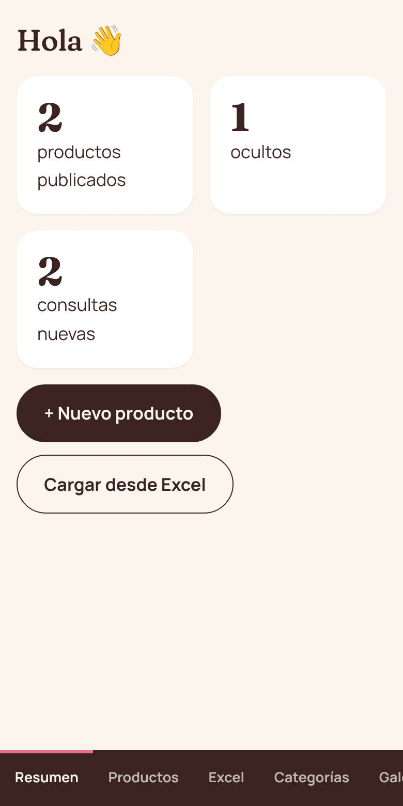
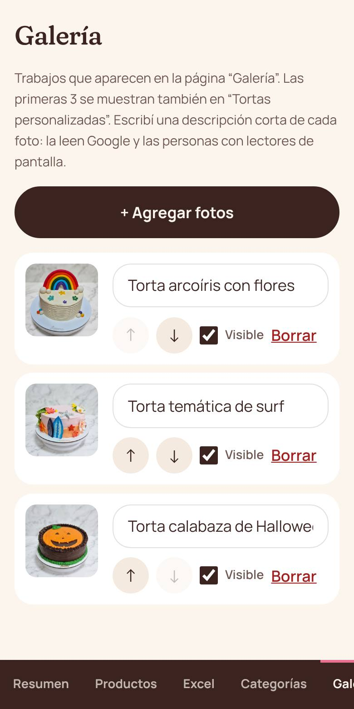

# Guía del panel de Amoma

Esta guía es para la dueña de Amoma. Explica cómo cargar y cambiar todo lo que se ve en la página,
**sin tocar código**. Se puede usar desde el celular o la compu.

> La dirección del panel es la de la página + `/admin`
> (por ejemplo `amoma-react.vercel.app/admin`).

---

## 1. Primera vez: crear tu contraseña y activar el doble factor

1. Te llega un **mail de invitación**. Tocá el link.
2. Elegí una contraseña **larga** (mínimo 15 letras). Lo más fácil es una frase:
   _"torta de limón los domingos"_.
3. Instalá en tu celular **Google Authenticator** o **Microsoft Authenticator** (gratis).
4. En la app tocá **"+"** y escaneá el código que muestra el panel.
5. Escribí los **6 números** que aparecen en la app. ¡Listo!

**¿Por qué el doble factor?** Aunque alguien consiga tu contraseña, sin tu celular no puede cambiar
nada de la página. Es la misma protección que usan los bancos.

## 2. Entrar

Email + contraseña, y después los 6 números de la app (cambian cada 30 segundos).
Si te olvidaste la contraseña, tocá **"Olvidé mi contraseña"** y te llega un mail.

Por seguridad, si dejás el panel abierto **30 minutos sin usar**, se cierra solo.

## 3. Resumen

Lo primero que ves: cuántos productos están publicados, cuántos ocultos y **cuántas consultas
nuevas** llegaron por el formulario de la página.

## 4. Productos

- **Visible / Oculto**: con el tilde decidís si se ve en la página (sin borrarlo).
- Tocá el nombre para **editarlo**. **"+ Nuevo"** para crear uno.

### Editar un producto

- **Nombre**, **categoría** y **descripción corta** (la que se ve en la tarjeta).
- **Tamaños y precios**: una fila por tamaño (ej. _Mediana · 15 porciones · 35000_).
  El precio va en pesos, sin puntos ni signo $ (igual los entiende).
- **Fotos**: tocá **"+ Agregar fotos"**. Se achican solas para que la página cargue rápido.
  La que tiene la **★** es la portada; tocá la estrella de otra para cambiarla.
- Para que se vea en la página tiene que tener **al menos un precio y una foto**.

## 5. Cargar todo desde Excel (lo más rápido)

1. Tocá **"Descargar planilla modelo"** y abrila con Excel.
2. Completá **una fila por tamaño**. Si una torta tiene 2 tamaños, van 2 filas con el mismo nombre.

   | nombre    | categoria        | descripcion           | tamaño | porciones | precio | foto          | publicado |
   | --------- | ---------------- | --------------------- | ------ | --------- | ------ | ------------- | --------- |
   | Lemon pie | Tartas y postres | Masa sablé y merengue | Chica  | 8         | 18000  | lemon-pie.jpg | sí        |
   | Lemon pie |                  |                       | Grande | 16        | 32000  |               |           |

3. Guardala y subila en **"Elegir planilla"**.
4. En **"Elegir fotos"** elegí todas las fotos juntas. Cada foto tiene que llamarse **igual** que lo que
   escribiste en la columna "foto".
5. Revisá la **vista previa**. Si hay algo mal, te dice en qué fila (ej. _"Fila 4: el precio no es
   válido"_). Corregilo en el Excel y volvé a subirlo.
6. Tocá **"Importar"**. Si algo falla, **no se guarda nada** (no queda a medias).

**Para actualizar precios** (por ejemplo, por inflación): cambiá los precios en el mismo Excel y
volvé a subirlo. Las tortas que ya existen se actualizan, no se duplican.

## 6. Galería

Las fotos de trabajos que se ven en la página "Galería". Las **3 primeras** aparecen también en
"Tortas personalizadas". Con las flechas **↑ ↓** cambiás el orden. Escribí una descripción corta de
cada foto: la usan Google y las personas que no ven bien.

## 7. Consultas

Lo que la gente manda desde el formulario de **Contacto**. Tocá el WhatsApp o el email para
responder, y después **"Marcar respondida"** para no perderle el rastro.

## 8. Ajustes

- **WhatsApp**: el número al que llegan todos los pedidos (con 549 adelante, ej. 5491136362466).
- **Instagram**, **zona**, **horarios**.
- **Aviso destacado**: una franja rosa arriba de toda la página. Ideal para
  _"Agenda de diciembre completa"_ o _"Cerrado por vacaciones hasta el 10/1"_. Dejalo vacío para sacarlo.

---

## Cuidados importantes 🔒

- **Nunca** le pases tu contraseña ni los 6 números a nadie. Nadie de soporte te los va a pedir.
- Si te llega un mail "urgente" pidiendo que entres a un link para "verificar tu cuenta", **no lo
  toques**: entrá escribiendo vos la dirección del panel.
- **Comprobantes de transferencia**: confirmá siempre en la app del banco que la plata entró antes de
  entregar. Las capturas y PDFs se falsifican fácil.
- Para tortas grandes o personalizadas, pedí **seña**.
- Si cambiás de celular, avisá antes para pasar el doble factor al nuevo.
