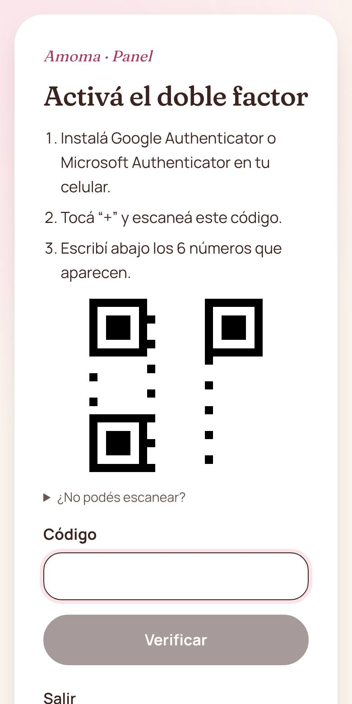
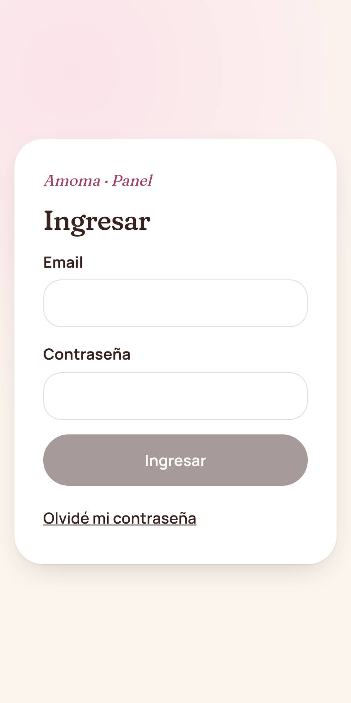
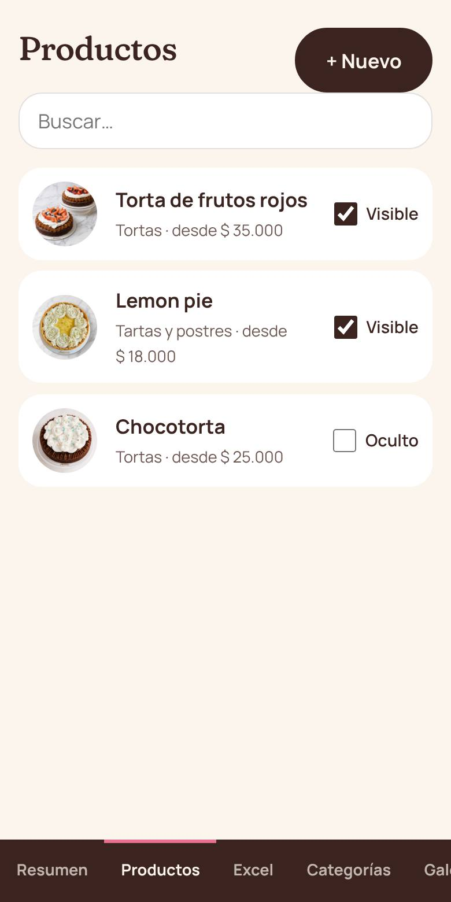
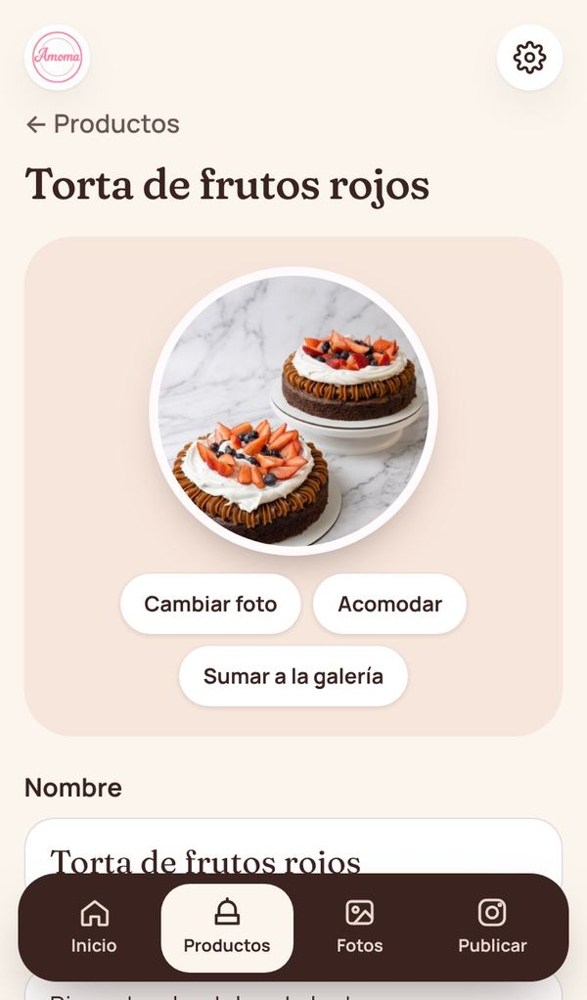
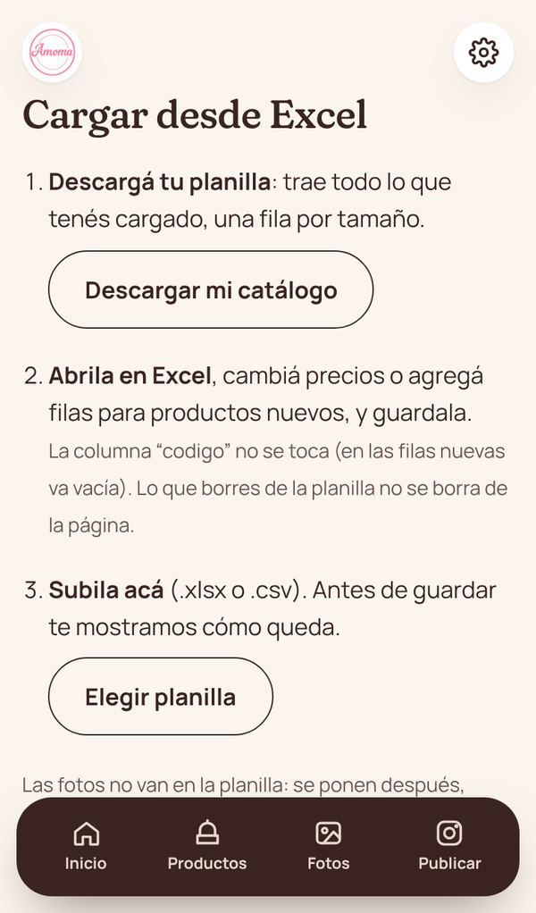
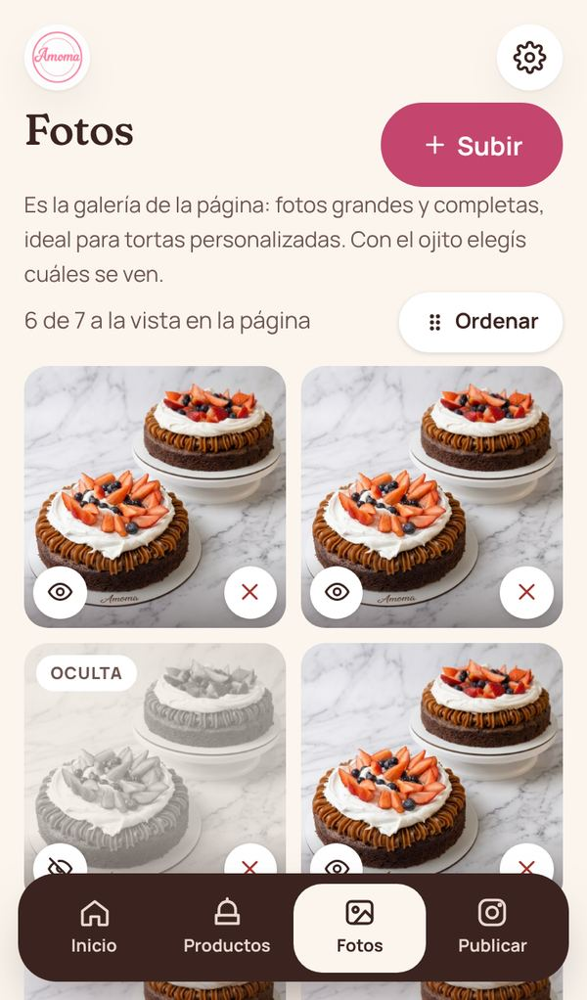
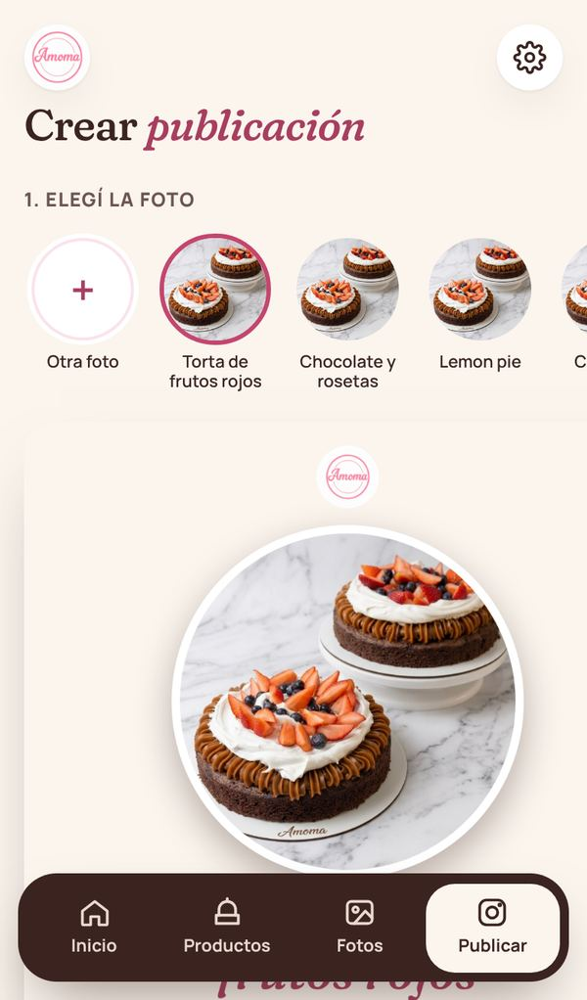
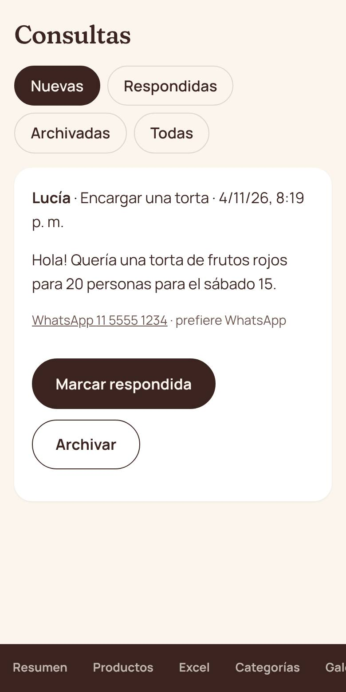
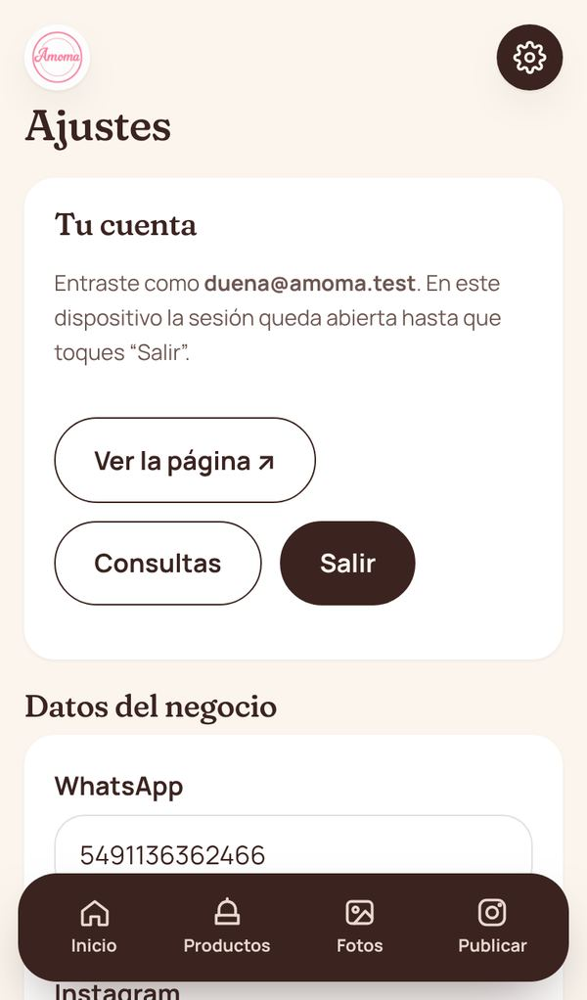

# Guía del panel de Amoma

Esta guía es para la dueña de Amoma. Explica cómo cargar y cambiar todo lo que se ve en la página,
**sin tocar código**. Se puede usar desde el celular o la compu.

> La dirección del panel es la de la página + `/admin`
> (por ejemplo `amoma-react.vercel.app/admin`).

---

## 1. Primera vez: crear tu contraseña y activar el doble factor

1. Te llega un **mail de invitación**. Tocá el link.
2. Elegí una contraseña **larga** (mínimo 15 letras). Lo más fácil es una frase:
   _"torta de limón los domingos"_.
3. Instalá en tu celular **Google Authenticator** o **Microsoft Authenticator** (gratis).
4. En la app tocá **"+"** y escaneá el código que muestra el panel.
5. Escribí los **6 números** que aparecen en la app. ¡Listo!

**¿Por qué el doble factor?** Aunque alguien consiga tu contraseña, sin tu celular no puede cambiar
nada de la página. Es la misma protección que usan los bancos.

## 2. Entrar

Email + contraseña, y después los 6 números de la app (cambian cada 30 segundos). Esto se pide **una
sola vez por dispositivo**: después el panel queda abierto en ese celular o compu hasta que toques
**Salir** (en el engranaje). Por eso el celular tiene que tener bloqueo (huella, cara o PIN).
Si te olvidaste la contraseña, avisale a quien administra la página (todavía no se recupera por mail).

## 3. Inicio

El panel tiene **4 secciones** (abajo en el celular, a la izquierda en la compu): **Inicio, Productos,
Fotos y Publicar**. El engranaje de arriba a la derecha es para los datos del negocio y para **Salir**.

En **Inicio** ves cuántos productos están a la vista, dos accesos grandes (**Cambiar precios** y
**Crear publicación**) y las **consultas nuevas**, con un botón verde para responder por WhatsApp.

## 4. Productos

- Las tortas aparecen como en la página, agrupadas por categoría. **Tocá una para editarla.**
- **"Cambiar nombre"** al lado de cada categoría cambia el título de esa tarjeta en la página (máx. 30
  letras). Las 4 categorías son fijas: no se agregan ni se borran.
- **"+ Agregar"** crea un producto nuevo: primero nombre y precios, después la foto.
- Un producto **sin foto** muestra el círculo **"+ Foto"**: hasta que tenga foto no aparece en la página.

### Editar un producto

- **La foto**: "Cambiar foto" te deja **elegir una que ya cargaste** (de la galería o de otro producto) o
  **subir una nueva**. Se guarda sola apenas la elegís. "Acomodar" es opcional (mover y acercar dentro
  del círculo). "Sumar a la galería" la agrega a la galería sin subirla de nuevo.
- **Nombre, descripción, categoría y etiqueta** ("Más pedido", "Nuevo", "De temporada").
- **Tamaños y precios**: uno por renglón. "+ Agregar tamaño" para sumar otro.
- **Mostrar en la página**: apagado, los clientes no lo ven (queda guardado en el panel).
- **Guardar cambios** guarda todo junto. Si algo falla, no se cambia nada.

## 5. Cambiar muchos precios juntos con Excel

En **Productos**, botón **"Excel"** (arriba, al lado de "Agregar").

1. **"Descargar mi catálogo"** baja una planilla de Excel con **todo lo cargado**, una fila por tamaño.
   (Si todavía no hay nada, **"Planilla vacía con ejemplos"**: las filas grises de ejemplo se ignoran
   al subirla.)
2. Abrila con Excel y cambiá lo que necesites:
   - **Precios**: escribí el número (ej. 28000).
   - **Nombres**: cambialos tranquila; cada torta se reconoce por su **código** (la columna gris
     "Código (no tocar)", un número que pone el panel solo y no cambia nunca).
   - **Producto nuevo**: agregá filas al final (una por tamaño) y dejá el código **vacío**: el panel le
     asigna uno.
   - **Sacar un tamaño**: borrá esa fila. Borrar todas las filas de una torta **no** la borra de la
     página (eso se hace desde la torta).
3. Guardala y subila en **"Elegir planilla"**.
4. Revisá la **vista previa**: muestra cada producto con su código o **"Nuevo"**. Si hay algo mal, te
   dice en qué fila (ej. _"Fila 4: el precio no es válido"_). Corregilo en el Excel y volvé a subirla.
5. Tocá **"Importar"**. Si algo falla, **no se guarda nada** (no queda a medias).

La segunda hoja de la planilla, **"Cómo usar"**, repite estas instrucciones y las categorías válidas.
En las columnas **Categoría** y **Publicado** tocás la celda y elegís de una **lista desplegable**
(si escribís otra cosa, Excel no la deja). La lista de categorías sale con los nombres que tengan
las tarjetas al momento de descargar: si cambiás un nombre, volvé a descargar la planilla.

**Las fotos no van en la planilla.** A los productos nuevos se las ponés después: en **Productos**,
tocá el círculo **"+ Foto"** de cada uno.

## 6. Fotos (la galería de la página)

- **"+ Subir"** para agregar varias fotos juntas.
- El **ojito** muestra u oculta cada foto al instante (la oculta queda en gris y sigue guardada).
- **"Ordenar"**: arrastrá cada foto desde su manija (los puntitos) y tocá **"Guardar orden"**. Las
  primeras 3 visibles salen también en "Tortas personalizadas".
- La **✕** la borra de la galería (si la usa un producto, ahí sigue).

## 6b. Publicar (imágenes para Instagram)

1. Elegí la torta (trae foto, nombre y precio) o **"Otra foto"** (una cargada o del celular).
2. Elegí **modelo** (Vitrina, Portada o Póster), **color** (crema o chocolate) y **formato** (cuadrado
   para el feed o historia). Con **"Mover y agrandar la foto"** la acomodás arrastrándola y con la
   barrita; en Vitrina también podés cambiar el tamaño del círculo.
3. Revisá el texto: el segundo renglón va en cursiva rosa; el precio se puede dejar vacío.
4. **"Descargar imagen"** (o "Compartir" en el celular) y subila a Instagram como siempre.

La imagen se arma en tu celular: no se conecta a Instagram ni se guarda en la página. Si marcás "Sumar
también la foto a la galería", la foto original (sin textos) se agrega a Fotos.

## 7. Consultas

Las nuevas aparecen en **Inicio**; todas están en el engranaje → **Consultas**. Es lo que la gente
manda desde el formulario de **Contacto**. Tocá el WhatsApp o el email para
responder, y después **"Marcar respondida"** para no perderle el rastro.

## 8. Ajustes (el engranaje)

- **Tu cuenta**: ver la página, ir a Consultas y **Salir**.

- **WhatsApp**: el número al que llegan todos los pedidos (con 549 adelante, ej. 5491136362466).
- **Instagram**, **zona**, **horarios**.
- **Aviso destacado**: una franja rosa arriba de toda la página. Ideal para
  _"Agenda de diciembre completa"_ o _"Cerrado por vacaciones hasta el 10/1"_. Dejalo vacío para sacarlo.

---

## Cuidados importantes 🔒

- **Nunca** le pases tu contraseña ni los 6 números a nadie. Nadie de soporte te los va a pedir.
- Si te llega un mail "urgente" pidiendo que entres a un link para "verificar tu cuenta", **no lo
  toques**: entrá escribiendo vos la dirección del panel.
- **Comprobantes de transferencia**: confirmá siempre en la app del banco que la plata entró antes de
  entregar. Las capturas y PDFs se falsifican fácil.
- Para tortas grandes o personalizadas, pedí **seña**.
- Si cambiás de celular, avisá antes para pasar el doble factor al nuevo.

## Si perdés o cambiás el celular

El código de 6 números vive en la app de tu celular. Si lo perdés o cambiás de teléfono, **no podés
entrar** hasta que Francisco te lo reinicie (en Supabase → Authentication → Users → tu usuario →
borrar el factor de doble factor). Después entrás con tu contraseña y escaneás un código QR nuevo.
Si cambiás de celular y todavía tenés el viejo, avisá **antes** de deshacerte de él.
